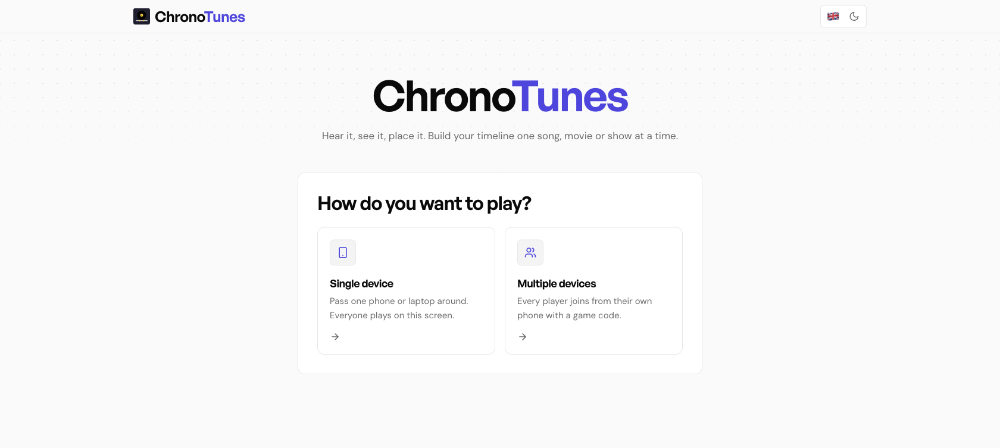

[](https://github.com/davidpastorvicente/chronoTunes/actions/workflows/deploy.yml)

# ChronoTunes

A timeline guessing game where players build chronological timelines by placing items in order. Play with songs, movies, or TV shows!



## 🎮 How to Play

1. **Choose Category**: Songs, Movies, TV Shows, or Mixed (all three interleaved)
2. **Setup Players**: Play on one shared device (1-6 players) or on several devices with a game code / invite link, and set a winning score (5, 10, 15, or 20 items)
3. **Experience**: Each turn, a player experiences a mystery item (song audio or movie/show image)
4. **Guess**: Place the item in your timeline by its year (before, between, or after existing items)
5. **Build**: Correct placements add the item to your timeline
6. **Win**: First player to reach the target number of items wins! If the deck runs out first, the leader wins (or it's a tie).

## 📚 Content Library

### 🎵 Music

503 songs (276 English, 227 Spanish), 251 movies and 249 TV shows.

**English Songs:**
- 1960s-1990s: Classic hits from The Beatles, Queen, Michael Jackson, Nirvana
- 2000s-2020s: Modern anthems from Beyoncé, Ed Sheeran, The Weeknd, Billie Eilish  
- 2010s party hits: Rihanna, Lady Gaga, Calvin Harris, Ariana Grande, Justin Bieber

**Spanish/Latin Songs:**
- Heavy emphasis on reggaeton and Latin pop
- Artists: Bad Bunny, Karol G, Ozuna, Rauw Alejandro, Maluma, ROSALÍA, Shakira
- Spanish pop/rock: La Oreja de Van Gogh, Amaral, El Canto del Loco, Mecano, Héroes del Silencio
- Focus on post-2000 music with 70+ songs from 2020s alone

### 🎬 Movies & TV Shows

**English Movies/Shows:**
- Classic films and iconic TV series from 1960s-2020s
- Mix of blockbusters, critically acclaimed films, and popular TV shows

**Spanish Movies/Shows:**
- Spanish-language cinema and television (TMDB `original_language=es`, ES region)

## 🎧 Media Playback

**For Songs:**
- **Deezer API**: every song has a Deezer ID and plays an ad-free 30-second preview with a progress bar
- **YouTube Fallback**: if Deezer has no preview for a track or doesn't answer within 5 s, a hidden YouTube embed plays instead (may show ads)
- Preview URLs are fetched dynamically at runtime for freshness
- Deezer is called directly from the browser via **JSONP** (`api.deezer.com/track/{id}?output=jsonp`).
  The Deezer API sends no CORS headers and the app has no backend, so a normal `fetch()` would be
  blocked; JSONP needs no CORS and no third-party proxy (the public CORS proxies used before stopped working).
  See `src/utils/deezer.js` and `src/utils/jsonp.js`.

**For Movies/TV Shows:**
- **Backdrop Images**: Scene stills shown during guessing phase (harder to identify)
- **Poster Images**: Official posters shown on reveal (clear identification)
- Images come from TMDB with permanent URLs; the app requests resized renditions (`w1280` backdrops, `w342` posters) instead of the multi-MB originals

## 🚀 Getting Started

Requires Node.js 22.22+ or 24.15+ (see `.nvmrc`).

```bash
npm install
cp .env.example .env   # optional: only needed for the password gate and multi-device mode
npm run dev            # http://localhost:5173/chronoTunes/
```

Single-device play works without any configuration. Multi-device play needs the
`VITE_FIREBASE_*` variables (see `.env.example` and the Firebase section below);
without them the option is shown as unavailable.

**Testing multi-device on real phones:** run `npm run dev -- --host` and open the
printed Network URL (e.g. `http://192.168.1.20:5173/chronoTunes/`) on each phone.
Over plain HTTP the "Copy" buttons may be unavailable (browsers only expose the
clipboard on secure origins); everything else works.

### Multi-device setup (Firebase)

1. Create a Firebase project and a **Realtime Database**.
2. Register a web app and copy its config into `.env` (`VITE_FIREBASE_*`).
3. Database rules: the app has no user accounts, so clients need read/write
   access to `games/`. For example:
   ```json
   { "rules": { "games": { "$code": { ".read": true, ".write": true } } } }
   ```
   Sessions are stored at `games/{CODE}`; see `AGENTS.md` for the layout.

## 🧑‍💻 Development

| Command | What it does |
| --- | --- |
| `npm run dev` | Vite dev server with HMR |
| `npm test` | Unit, component and integration tests (Vitest + Testing Library) |
| `npm run test:watch` | Tests in watch mode |
| `npm run test:coverage` | Tests with a V8 coverage report (`coverage/`) |
| `npm run lint` | ESLint |
| `npm run docs:machines` | Regenerate `docs/state-machines.md` from the machine definitions |
| `npm run check` | Lint + tests + production build (run this before pushing) |

### Deployment

Pushing to `main` runs `.github/workflows/deploy.yml`: lint, tests, build,
then deploy to GitHub Pages under `/chronoTunes/`. Configure these repository
secrets: `FIREBASE_API_KEY`, `FIREBASE_AUTH_DOMAIN`, `FIREBASE_DATABASE_URL`,
`FIREBASE_PROJECT_ID`, `FIREBASE_STORAGE_BUCKET`, `FIREBASE_MESSAGING_SENDER_ID`,
`FIREBASE_APP_ID` and `APP_PASSWORD`. The workflow currently builds with
`VITE_DISABLE_AUTH: true`, so the password gate is **off** on the deployed site;
set it to `false` to enable it.

## 🛠 Tech Stack

- **React** - UI framework
- **Vite** - Build tool & dev server
- **Firebase Realtime Database** - Multi-device sync
- **Deezer API** - Ad-free audio previews (30 seconds), loaded via JSONP
- **TMDB API** - Movie/TV show data and images
- **YouTube Embeds** - Fallback audio playback
- **Vitest + Testing Library** - Tests
- **CSS custom properties** - "Genesis" design tokens (see `DESIGN.md`) with light/dark themes

## 🎯 Content Sources

### Songs
- **Data structure**: Title, artist, year, YouTubeId, DeezerId
- **Playback**: Deezer preview URLs (fetched at runtime, expire after 24h)
- **Album covers**: Fetched at runtime from Deezer API
- **Fallback**: YouTube embeds for songs without Deezer previews

### Movies/TV Shows
- **Data structure**: Title, year, backdropUrl, posterUrl, tmdbId, type
- **Images**: TMDB permanent URLs (don't expire)
- **Hint phase**: Backdrop images (scene stills)
- **Reveal phase**: Poster images (official artwork)
- **Origin filtering**: Spanish content filtered by Spain specifically

## 🔧 Key Features

### Explicit State Machines
- All non-trivial state (screens, password gate, setup wizard, gameplay, audio player) is an explicit, pure state machine in `src/machines/`
- The **same game machine** runs single-device games (`useReducer`) and multi-device games (inside Firebase transactions), so the rules can't drift apart
- Events a state doesn't accept are ignored, so double clicks and stale devices can't corrupt a game
- Diagrams in [`docs/state-machines.md`](docs/state-machines.md) are generated from the code and checked by a test

### Design System
- Built on the "Genesis" `DESIGN.md` (indigo accent, General Sans / DM Sans / JetBrains Mono, 4px grid, flat cards)
- Accessible by default: native radio groups, labelled inputs, visible focus, `prefers-reduced-motion`, 44px touch targets
- Light and dark themes, applied before first paint

### Media-Agnostic Architecture
- Generic terminology: "items" instead of "songs"
- `category` field: 'songs', 'movies', 'shows', or 'all'
- `contentSet` field: 'everything', 'english', 'spanish', or 'new' (2010+)
- Components work across all media types
- Easy to extend with new categories in future

## 📝 Features

- ✅ **Multiple categories**: Songs, Movies, and TV Shows
- ✅ Turn-based gameplay for multiple players
- ✅ **Single-device mode** (hot-seat multiplayer)
- ✅ **Multi-device mode** (real-time sync via Firebase)
- ✅ Configurable winning conditions
- ✅ **Content filtering**: Everything, English only, Spanish only, or Recent (2010+)
- ✅ Hidden media (audio for songs, scene images for movies/shows)
- ✅ Play/Pause/Replay controls with a progress bar for audio previews
- ✅ Placement "slots" showing the exact gap (before / between / after a year)
- ✅ Timeline axis grouped by year with pastel colour-coded items; the item just placed is highlighted and scrolled into view
- ✅ Invite links (`?join=CODE`) and live lobby
- ✅ Remembers your settings and player names
- ✅ Reloading the page resumes the game or lobby you were in (per browser tab)
- ✅ Immediate feedback on correct/incorrect placements
- ✅ Winner announcement with full timeline
- ✅ Light/dark themes (follows the system on first visit)
- ✅ Bilingual support (English/Spanish)

## 🎨 Customization

### Adding Movies/TV Shows from TMDB

Use the automated script to fetch movies or TV shows separately:

```bash
# Fetch movies (250 per language = 500 total)
python3 scripts/fetch-movies.py movies --count 250

# Fetch TV shows (250 per language = 500 total)
python3 scripts/fetch-movies.py shows --count 250
```

**Requirements:**
- TMDB API key (set as `TMDB_API_KEY` environment variable)
- Both `backdrop_path` AND `poster_path` must be present
- All content uses ES region with language filtering (original_language=en/es)

The script will:
- ✅ Fetch movies or TV shows from TMDB `/discover` endpoints
- ✅ Use ES region filters with original language filtering
- ✅ Apply date distribution: 5% pre-1990, 80% 1990-2019, the rest 2020+
- ✅ Include backdrop URLs (for hint phase) and poster URLs (for reveal phase)
- ✅ Generate `src/data/movies.json` or `src/data/shows.json`
- ✅ Include title, year, backdrop, poster, TMDB ID, type, and language fields

### Checking for Duplicates

Check for duplicate songs in the database:

```bash
python3 scripts/check-duplicates.py
```

This will scan `src/data/songs.json` (English and Spanish songs) for:
- 🔴 Duplicate Deezer IDs
- 🔴 Duplicate YouTube IDs  
- 🔴 Duplicate titles (case-insensitive)

**When duplicates are found**, the script automatically:
1. Re-fetches the correct YouTube ID for each song (using `ytmusic.search()`)
2. Re-fetches the correct Deezer ID for each song (using Deezer search API)
3. Shows you the new correct IDs

**To automatically fix the files:**
```bash
python3 scripts/check-duplicates.py --fix
```

This will update the data files with the correct IDs.

### Validating Song Titles

Validate that song titles in the database match Deezer API:

```bash
python3 scripts/check-titles.py
```

This will:
- Fetch the actual title from Deezer API using each song's `deezerId`
- Compare it with the title stored in the database
- Flag any mismatches (ignoring accents, case, and special characters)

**Note:** Some mismatches are acceptable (e.g., remaster notes, featured artists). The database intentionally keeps cleaner titles while Deezer includes extra metadata like "(Remastered 2015)" or "(feat. Artist)".

### Adding Songs from YouTube Playlists

Use the automated script to add entire playlists:

```bash
python3 scripts/add-playlist.py PLAYLIST_ID

# Or with full URL:
python3 scripts/add-playlist.py "https://music.youtube.com/playlist?list=..."

# For Spanish songs:
python3 scripts/add-playlist.py PLAYLIST_ID --language es

# For large playlists, limit to first N successful imports:
python3 scripts/add-playlist.py PLAYLIST_ID --limit 50
```

The script will:
- ✅ Fetch all tracks from the playlist (titles and artists)
- ✅ Clean titles by removing parentheses/brackets (done twice: before search and after receiving YouTube data)
- ✅ Optionally process until N songs are successfully imported
- ✅ Search for official YouTube video IDs (ensures best/canonical versions)
- ✅ Get YouTube IDs, Deezer IDs, album covers, and years
- ✅ Remove duplicates automatically
- ✅ Append formatted songs to `src/data/songs.json` (sorted by year)

**Note:** When using `--limit 50`, the script keeps processing songs until 50 are successfully imported (skipping any that fail).

### Adding Individual Songs

To add songs manually, edit `src/data/songs.json` and add entries **without any IDs**:

```json
{
  "title": "Your Song Title",
  "artist": "Artist Name",
  "year": 2024,
  "type": "song",
  "language": "en"
}
```

Then run the automatic ID updater:

```bash
python3 scripts/update-ids.py
```

The script will automatically:
- ✅ Fetch YouTube IDs from YouTube Music API
- ✅ Fetch Deezer IDs from Deezer API (for ad-free playback)
- ✅ Update the data files with both IDs

### Manual ID Entry

You can also add songs with IDs directly:

```json
{
  "title": "Your Song Title",
  "artist": "Artist Name",
  "year": 2024,
  "youtubeId": "youtube_video_id",
  "deezerId": "deezer_track_id",
  "type": "song",
  "language": "en"
}
```

**Note:** Do NOT add `albumCover` or `previewUrl` - these are fetched at runtime.

For movies/TV shows:

```json
{
  "title": "Movie Title",
  "year": 2024,
  "backdropUrl": "https://image.tmdb.org/t/p/original/...",
  "posterUrl": "https://image.tmdb.org/t/p/original/...",
  "tmdbId": "12345",
  "type": "movie",
  "language": "en"
}
```

For TV shows, use `"type": "show"` instead of `"movie"`.

## 📦 Project Structure

```
src/
├── machines/          # Pure state machines (app, auth, setup, game, player) + docs generator
├── game/              # Pure game logic: rules, deck drawing, Firebase session mapping
├── hooks/             # React glue: useSetup, useLocalGame, useOnlineGame, useCopyToClipboard
├── services/          # Firebase session API (transactions, subscriptions)
├── components/
│   ├── ui/            # Design-system primitives (Button, ChoiceGroup, TextField, Icon, DotGrid)
│   ├── setup/         # Setup wizard and lobby
│   ├── game/          # Game screen, player, timeline, result, game over
│   ├── AppHeader.jsx  # Sticky nav (status, language, theme)
│   └── AuthGate.jsx   # Password gate
├── i18n/              # en.json, es.json and translate()
├── preferences/       # Language + theme provider
├── styles/            # tokens.css (design tokens), base, components, screens
├── utils/             # Deezer previews (JSONP), media loading, images, randomness
├── data/              # songs.json, movies.json, shows.json
├── test/              # Test setup and fixtures
└── firebase.js        # Lazily loaded Firebase
docs/state-machines.md # Generated state machine diagrams
scripts/               # Python data-maintenance scripts + machine docs generator
DESIGN.md              # Genesis design system (+ ChronoTunes adaptations)
AGENTS.md              # Architecture and conventions for contributors and AI agents
```

See [`AGENTS.md`](AGENTS.md) for architecture details and conventions.

## 🎯 No API Keys Required!

Single-device play uses the curated lists in `src/data` - just clone and play!

---

Enjoy the game! 🎵
