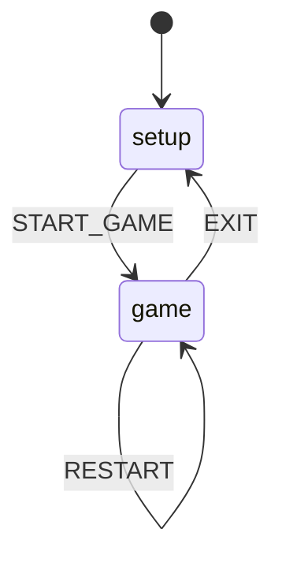
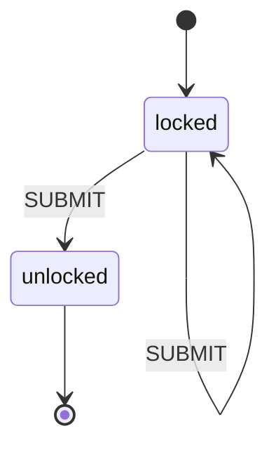
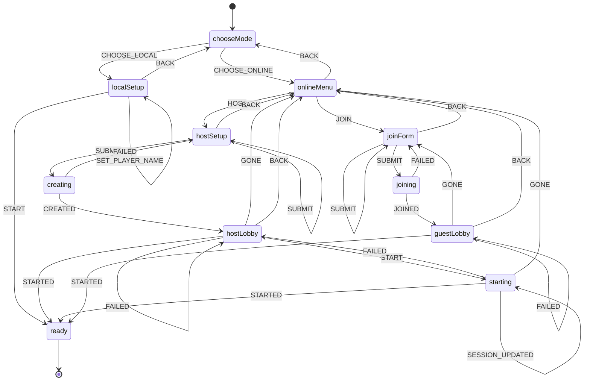
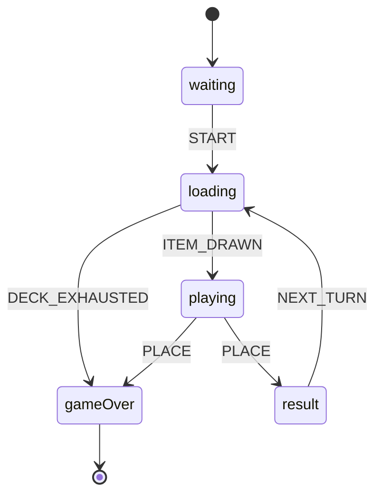
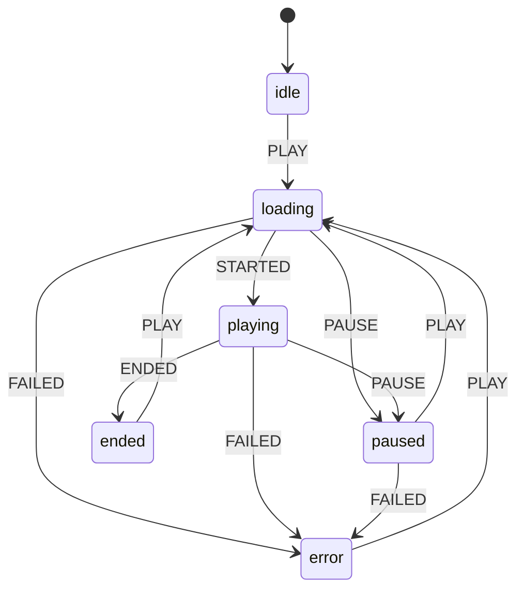

# State machines

<!-- Generated by `npm run docs:machines` from src/machines/*. Do not edit by hand. -->

Every piece of non-trivial UI/game state is an explicit, pure state machine built
with `createMachine` (`src/machines/createMachine.js`). Machines are plain data +
pure functions: React runs them with `useReducer`, Firebase runs the game machine
inside transactions, and tests call `machine.transition(state, event)` directly.
Events a state does not accept are ignored (the same state object is returned),
so double clicks and stale network events are harmless.

## `app`

Defined in `src/machines/appMachine.js` · used by `src/App.jsx`

| State | Description | Events |
| --- | --- | --- |
| `setup` | Choosing mode and settings. | `START_GAME` |
| `game` | A game is in progress (or just finished). | `RESTART`, `EXIT` |

## `auth`

Defined in `src/machines/authMachine.js` · used by `src/components/AuthGate.jsx`

| State | Description | Events |
| --- | --- | --- |
| `locked` | Waiting for the password. | `SUBMIT` |
| `unlocked` | Access granted for this browser session. | — (final) |

## `setup`

Defined in `src/machines/setupMachine.js` · used by `src/hooks/useSetup.js`

| State | Description | Events |
| --- | --- | --- |
| `chooseMode` | Pick single-device or multi-device play. | `CHOOSE_LOCAL`, `CHOOSE_ONLINE` |
| `localSetup` | Configure a pass-and-play game on this device. | `UPDATE_SETTINGS`, `SET_PLAYER_COUNT`, `SET_PLAYER_NAME`, `START`, `BACK` |
| `onlineMenu` | Host a new game or join an existing one. | `HOST`, `JOIN`, `BACK` |
| `hostSetup` | Host picks settings and their own name. | `UPDATE_SETTINGS`, `SET_NAME`, `SUBMIT`, `BACK` |
| `creating` | Creating the session in Firebase. | `CREATED`, `FAILED` |
| `hostLobby` | Host shares the code and waits for players. | `SESSION_UPDATED`, `STARTED`, `START`, `FAILED`, `GONE`, `BACK` |
| `starting` | Host asked Firebase to start; waiting for confirmation. | `SESSION_UPDATED`, `STARTED`, `FAILED`, `GONE` |
| `joinForm` | Guest enters the game code and their name. | `SET_JOIN_CODE`, `SET_NAME`, `SUBMIT`, `BACK` |
| `joining` | Adding the guest to the Firebase session. | `JOINED`, `FAILED` |
| `guestLobby` | Guest waits for the host to start. | `SESSION_UPDATED`, `STARTED`, `FAILED`, `GONE`, `BACK` |
| `ready` | Setup finished; `config` describes the game to start. | — (final) |

## `game`

Defined in `src/machines/gameMachine.js` · used by `src/hooks/useLocalGame.js (useReducer)`, `src/game/session.js (Firebase transactions)`

| State | Description | Events |
| --- | --- | --- |
| `waiting` | Lobby. Players can still join (multi-device only). | `START` |
| `loading` | The active device is drawing and preparing the next item. | `ITEM_DRAWN`, `DECK_EXHAUSTED` |
| `playing` | The active player listens/looks and picks a position. | `PLACE` |
| `result` | Everyone sees whether the placement was correct. | `NEXT_TURN` |
| `gameOver` | Someone reached the winning score or the deck ran out. | — (final) |

## `player`

Defined in `src/machines/playerMachine.js` · used by `src/components/game/SongPlayer.jsx`

| State | Description | Events |
| --- | --- | --- |
| `idle` | Nothing played yet. | `PLAY` |
| `loading` | Waiting for the media to start. | `STARTED`, `FAILED`, `PAUSE` |
| `playing` | Audio is audible. | `PAUSE`, `ENDED`, `FAILED` |
| `paused` | Paused by the user. | `PLAY`, `FAILED` |
| `ended` | Preview finished; can replay. | `PLAY` |
| `error` | Media could not be played. | `PLAY` |
